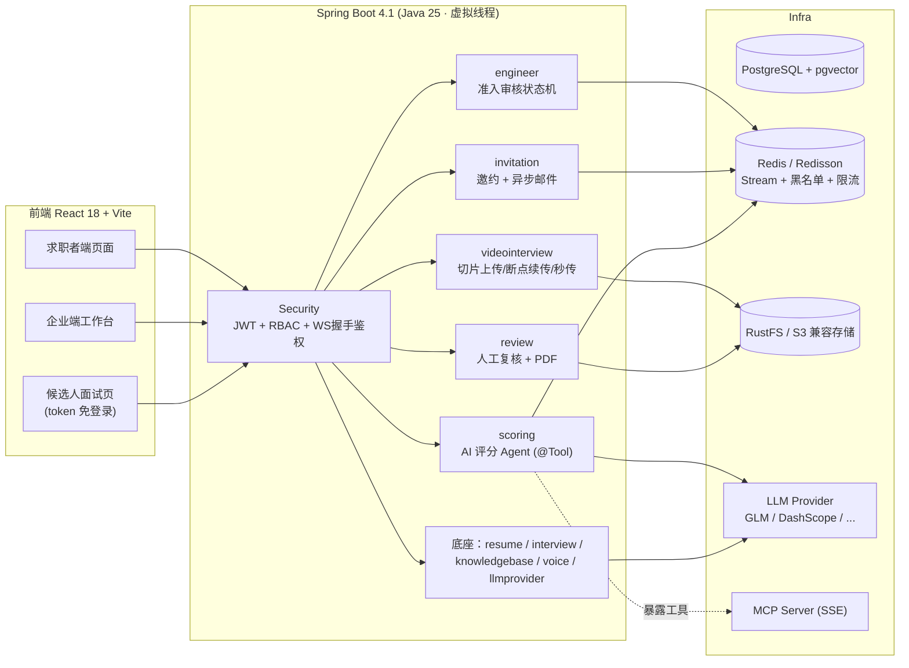

# AI Interview Platform — 双端智能面试平台（视频面试 + AI 评分）

> 求职者端的智能面试练习 + 企业端的供应商工程师视频面试与 AI 评分闭环。
> 基于 [Snailclimb/interview-guide](https://github.com/Snailclimb/interview-guide)（AGPL-3.0）二次开发，
> 在保留其求职者端能力的基础上，**设计并实现了全新的企业端 B 端模块**（见下方「二次开发贡献」）。
> 上游原始说明见 [README-upstream.md](README-upstream.md)。

[](LICENSE)


## 项目定位

一个平台，两端角色：

- **求职者端（C 端）**：简历智能分析、文字/语音模拟面试（Skill 出题 + 智能追问）、知识库 RAG 问答 —— 来自开源底座。
- **企业端（B 端）**：面向车企供应商准入场景，覆盖「工程师资料录入 → 简历审核 → 邮件邀约 → 设备预检 → 视频面试录制 → 切片上传归档 → AI 评分 → 人工复核 → PDF 归档」的完整闭环 —— 本次二次开发的核心贡献。

两端共用同一套 AI 基建：统一 LLM 多模型接入层、结构化输出、Redis Stream 异步任务模板、限流与审计。

## 架构总览



## 二次开发贡献（本仓库新增）

| 模块 | 亮点 | 关键词 |
|---|---|---|
| 认证与 RBAC | JWT 双令牌（access 2h / refresh 7d）、登出 Redis jti 黑名单、五角色（求职者/业务负责人/审核人/面试官/管理员）、`@PreAuthorize` 方法级授权 + 合作伙伴组织级数据隔离、WebSocket 握手 JWT 鉴权 | `spring-boot-starter-security` `jjwt` `BCrypt` |
| 工程师准入 | 录入→审核→驳回重提状态机、全流程审计日志（engineer_audit_logs）、简历 Tika 解析入库 | 状态机 审计留档 |
| 面试邀约 | 邮件邀约经 **Redis Stream 异步投递**（重试 3 次 + mailStatus 投递状态机），SMTP 未配置时 Mock 模式；候选人凭一次性 token 免登录确认 | 异步任务 幂等 |
| 视频面试 | 浏览器 MediaRecorder 录制；**切片上传 + 断点续传 + 秒传**：客户端 SHA-256 指纹 → init 秒传校验（CAS 登记表）→ 分片幂等落盘（服务重启可续传）→ complete 校验齐全后合并、大小比对、归档 RustFS；答卷 JSON 入库 | 弱网稳定性 内容寻址 |
| AI 评分 Agent | **tool-calling Agent**：模型自主调用 4 个信息工具（评分标准/画像/简历/答卷）收集证据后结构化输出多维评分 + 风险点 + 三档建议（BeanOutputConverter）；工具链路异常自动降级单轮内联；Redis Stream 异步执行 | Spring AI 2.0 Agent |
| 人工复核 | 复核工作台：视频流式回放（S3 流式，不整载内存）+ 答卷 + AI 报告并列，人工定夺写审计；iText 8 PDF 归档报告（CJK 字体） | AI 与人工分离存储 |
| MCP Server | 通过 `spring-ai-starter-mcp-server-webmvc`（SSE）对外暴露 `getInterviewScoreReport` / `getScoringStandards` 工具，供外部 Agent 生态集成 | Model Context Protocol |

底座已有能力（简历异步分析、文字/语音模拟面试、RAG 知识库、多模型配置等）见
[上游仓库 README](README-upstream.md)。

## 快速开始

### 0. 环境要求

- JDK 25（Gradle Toolchain 自动识别，`GRADLE_USER_HOME` 建议自定义）
- Docker Desktop（WSL2 后端，Windows 家庭版即需 WSL2）
- Node.js 20+ / pnpm 10+

### 1. 启动依赖服务

```bash
docker compose -f docker-compose.dev.yml up -d   # PostgreSQL16+pgvector / Redis7 / RustFS
```

### 2. 配置 `.env`

```bash
cp .env.example .env   # 至少填写：
# AI_BAILIAN_API_KEY         语音 ASR/TTS（占位符仅保证可启动）
# PROVIDER_GLM_API_KEY       文字模型（GLM 免费模型即可跑通全部 AI 功能）
# APP_AI_CONFIG_ENCRYPTION_KEY / APP_AUTH_JWT_SECRET   本地随机串
```

国内网络注意：Gradle Wrapper 已指向腾讯云镜像；Docker 需自行配置 registry-mirrors；
npm 建议走 npmmirror。

### 3. 启动后端与前端

```bash
./gradlew bootRun            # 后端 :8080（bootRun 自动加载根目录 .env）
cd frontend && pnpm install && pnpm dev   # 前端 :5173
```

首次启动自动执行：Flyway 迁移（用户/组织/工程师/邀约/视频会话等表）+ 创建默认管理员
`admin / admin123`（请在登录后尽快修改）。

### 4. 体验 B 端闭环

1. `reviewer1 / admin123` 登录 → 侧栏「人工复核」；
2. 用 `partnerA / admin123`（合作伙伴业务负责人）在「工程师准入」录入工程师并上传简历；
3. reviewer 审核通过 → 发送面试邀约（SMTP 未配置时邮件以日志模拟）；
4. 从邮件链接（或「邀约确认页 → 进入面试」）以候选人身份完成设备预检、录制、上传、答卷；
5. 回到复核工作台：触发 AI 评分 → 查看视频回放与答卷 → 人工定夺 → 下载 PDF 归档报告。

## 测试

```bash
./gradlew :app:test --no-daemon
cd frontend && pnpm run build
```

## Roadmap

- [ ] 异步任务死信队列（DLQ）与死信重放接口
- [ ] 候选人视频上传直传对象存储（预签名 URL），服务端只做会话管理
- [ ] 面试视频异步转码 MP4（FFmpeg 任务挂 Redis Stream）
- [ ] 语音面试接入 WebRTC 降低端到端延迟（延续上游方向）
- [ ] 视频帧抽取 + VLM 多模态评分（仪态/表达维度）
- [ ] A2A 协议接入多 Agent 协作

## 开源协议与致谢

- 本项目继承上游 [Snailclimb/interview-guide](https://github.com/Snailclimb/interview-guide) 的 **AGPL-3.0** 协议，修改部分同样以 AGPL-3.0 开源；
- 感谢上游作者与社区提供的求职者端基础能力；
- 企业端准入模块为独立设计实现，业务蓝本来自作者实习期间接触的供应商工程师面试流程。
